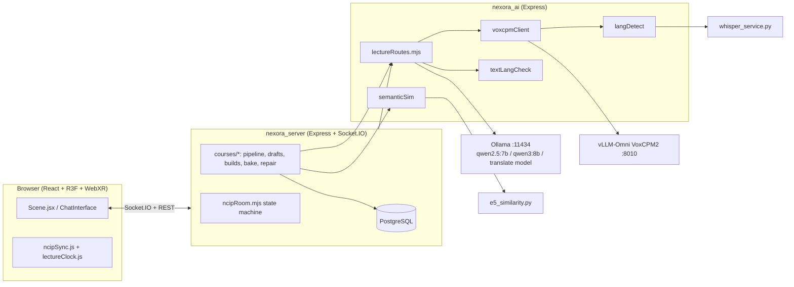

# Evaluation Basis Report — NexoraXR / WuFlux

*Purpose: foundation document for the thesis evaluation chapter. Investigated
2026-11-06 on branch `fix/gpu-memory` (includes all fix batches 1–3, the
language-switch/repair hardening, and the in-progress GPU-memory work).*

---

# PART 1 — WHAT WE BUILT

## 1. One-paragraph summary

NexoraXR (app name **WuFlux**) is a web-based, WebXR-capable virtual classroom:
an instructor uploads course PDFs, a pipeline extracts text (with OCR
fallback), chunks and embeds it for retrieval, plans a lecture, generates an
English narration script, and — after instructor review — translates it into
Arabic, French, German, Spanish and Chinese and pre-bakes professor audio per
segment in all six languages with automated language verification. In the live
classroom, students join public rooms or invite-only private rooms, see the
professor avatar lecture (audio + word-synced transcript + PDF slides), can
raise their hand, pause the lecture at an exact playback checkpoint, ask
questions answered by a RAG-grounded LLM and spoken by the professor's cloned
voice, and can switch the whole room's language mid-lecture. Late joiners
receive a state snapshot and can request a generated "Catch Me Up" recap in
the room language. Rendering is Three.js/React Three Fiber with optional
WebXR (`@react-three/xr`).

## 2. Architecture

| Service | What it does | Communicates via |
|---|---|---|
| `src/nexora_client` — React 18 + Vite frontend | Three.js scene (React Three Fiber, drei, `@react-three/xr`), classroom UI, chat/transcript, instructor course UI | Socket.IO client (`socket.io-client` 4.8.3) + REST `/api/*` |
| `src/nexora_server/server.js` — Express + Socket.IO backend | Auth (magic-link), room registry, NCIP event handlers, course-build orchestration, proxies `/api/*` to the AI service | Socket.IO server; HTTP to nexora_ai |
| `src/nexora_server/protocol/ncipRoom.mjs` — **NCIP** | Server-authoritative per-room state machine (professor status, floor, checkpoint, lecture progress, language, state versions) | Called by server.js; effects broadcast over Socket.IO |
| `src/nexora_ai` — AI routes (`routes/lectureRoutes.mjs`) | Segments manifest, lazy segment audio, `/api/ask` Q&A, `/api/recap` Catch-Me-Up, utterances, translation | HTTP (called by frontend and by server.js); TTS→VoxCPM; LLM→Ollama |
| **Ollama** (`localhost:11434`) | LLM: script plan/draft helpers, Q&A answers, utterances, segment translation, utterance generation; embeddings endpoint available | `POST /api/generate`, `/api/chat`, `/api/embed` (`ollamaClient.mjs`) |
| **VoxCPM2 via vLLM-Omni** (`localhost:8010`) | TTS with voice cloning (`abed101` + per-language refs `abed101_ar/fr/de/es/zh`) | `POST /v1/audio/speech` (`voxcpmClient.mjs`) |
| **Whisper** (`whisper_service.py`, persistent since batch 3) | Language verification of synthesized WAVs (windowed `detect_language` + transcribe second opinion) | stdin/stdout JSON lines (`langDetect.mjs`); spawn fallback |
| **multilingual-e5-small** (transformers, voxcpm env) | Semantic similarity gate for translations (`scripts/e5_similarity.py`, `modules/semanticSim.mjs`) | subprocess JSON on stdin/stdout |
| **PostgreSQL** | users, sessions, classrooms, courses, course_lectures.artifacts, course_builds, course_chunks (+ float8[] embeddings), guest tokens | `pg` pool (`db/pool.mjs`); embedded PG on :5433 for dev (`npm run db:start`) |

## 3. Hardware and models in use today

**Host:** Intel Core Ultra 7 265K (20 cores), 62 GiB RAM, Linux 6.17 (Ubuntu OEM).
**GPU:** NVIDIA RTX 4000 Ada, **20,475 MiB** VRAM (vLLM ~12–13 GiB resident).

| Model | Version/ID | Env var | Placement | Context/memory config |
|---|---|---|---|---|
| Course LLM (plans, scripts, utterance text, Q&A) | `qwen2.5:7b` (default) | `OLLAMA_MODEL` | GPU when free, else CPU; unloaded before bake | `COURSE_LLM_CTX=16384` for course builder |
| Translation model | `qwen2.5:7b` (default; qwen3 supported, `think:false`) | `OLLAMA_TRANSLATE_MODEL` | same | `num_ctx:2048`, `keep_alive:'30m'` |
| Strong translation rescue | `qwen3:8b` | `OLLAMA_STRONG_TRANSLATE_MODEL` | invoked once per stubborn segment (`translateForLecture`) | `temperature:0.15` |
| TTS | `openbmb/VoxCPM2` on vLLM-Omni | `VOXCPM_MODEL`, `VOXCPM_BASE_URL` | GPU | `--gpu-memory-utilization ${VOXCPM_GPU_MEM_UTIL:-0.35}` (verified floor 0.20; fixed footprint ~12.8 GiB), `VOXCPM_MAX_MODEL_LEN` optional |
| Whisper (audio lang-verify) | `base` or `small` | `WHISPER_MODEL`, `WHISPER_DEVICE` | GPU only with >7 GiB free, else CPU | persistent `whisper_service.py` |
| Semantic similarity | `intfloat/multilingual-e5-small` | — (script constant) | CPU | one model load per call |
| RAG embeddings | OpenAI `text-embedding-3-small` | `OPENAI_API_KEY` (fallback embedder if unset — see note) | API | float8[] in `course_chunks.embedding` |
| Speech recognition (student questions) | Browser Web Speech | `speechLang` in `src/shared/languages.mjs` | client-side | — |

*Note: `OLLAMA_URL`/`OLLAMA_BASE_URL` both honored; VoxCPM `keep_alive` does not
apply (vLLM service is persistent). GPU handoff: `unloadModel()` evicts both
Ollama models with `keep_alive:0` before VoxCPM baking (`runAudioPhase`,
builds.mjs).*

---

# PART 2 — HOW IT WORKS

## 4. Course-creation pipeline

| # | Step | Input → Output | Model/service | Storage |
|---|---|---|---|---|
| 1 | Course + room create | instructor form → course row, `pub_`/`priv_` classroom row (+ invite token) | — | Postgres `courses`, `classrooms` |
| 2 | Upload + extract | PDF → per-page text; `<20` non-space chars/page → OCR | `pdf-parse` pagerender; `pdftoppm` + **tesseract.js** WASM (`COURSE_OCR`, `OCR_DPI=150`) | `course_documents`, `course_sections` |
| 3 | Chunk + embed | sections → 700-word chunks, 120 overlap, never cross pages → embeddings | OpenAI `text-embedding-3-small` batched ×50 (`courses/llm.mjs:embed`) | `course_chunks.embedding` (float8[], cosine in JS — **no pgvector**) |
| 4 | Lecture plan | chunks → topics/segments plan | `OLLAMA_MODEL` (`COURSE_LLM_CTX=16384`) | `profbrain/lectures/<id>/lecture_plan.json`, `course_plans` |
| 5 | English script | plan → narration segments `{id,text,doc,page}` | same LLM | `segments.json` (versioned), `summary.json`, `slide_map.json` |
| 6 | Review/approval | instructor edits script, approves | — | `segments.json` `version`/`edited`; approval fingerprints in `course_builds.stats.approved` |
| 7 | Translation | canonical text → per-lang drafts | `translateForLecture` chat-template (`<source>`/`<translation>`), `OLLAMA_TRANSLATE_MODEL`, temp ≤0.3, `num_ctx:2048` | `profbrain/lectures/<id>/translations/<lang>.json` + `lecture_cache/segments/<id>__<lang>/segment_NNN.txt` |
| 7a | — checks per attempt | empty / identical-to-source / too-short (0.30, zh 0.15) / `validateTranslation` (script audit, franc top-match + stopword signal, foreign-word, leaked-meta) / semantic sweep e5 ≥0.78 | `textLangCheck.mjs`, `semanticSim.mjs` | rejections logged `[translate] rejected …reason=` |
| 7b | — retries/fallbacks | 3 attempts → 1–2 strong-model (`OLLAMA_STRONG_TRANSLATE_MODEL` qwen3:8b) draws → per-segment failure recorded; language status `ready`/`repaired`/`partial`/`failed`/`kept-*`/`needs-review` | counters in `bakeStats.mjs` | `failedSegments` ids in build stats; `artifacts.partial_langs` |
| 8 | Utterances | opening/transition/recap/reexplain/group_recap per lang | `generateLectureUtterance` — LLM-generated **in the room language** (system prompt + `<utterance>` tags + validation; template fallback `UTTERANCE_FALLBACK_TEXT`); opening is deterministic | `ANSWERS_DIR/utt_*.{txt,wav}` |
| 9 | Audio + verification | translated txt → WAV per segment; non-en clips verified per 3 s window (≥0.7-confident foreign window fails; transcribe 2nd opinion; proper-noun allowance; score≥half windows); duration ratio vs English (`checkDurationRatios`, band 0.5–3.0) | VoxCPM2 (+ per-lang `abed101_<lang>` refs) + whisper_service | `lecture_cache/segments/<id>__<lang>/segment_NNN.wav` (+`_lipsync.json` markers), `artifacts.duration_flags` |
| 10 | Readiness | `isLanguageReady` = txt+wav for every canonical segment (+ utterances) | `protocol/languageReady.mjs` | blocks `language.change` and `lecture.start` (ready-only menu since batch 3+) |
| 11 | Repair | `courses/repair.mjs` — boot-time + `POST /api/…/repair` backfills holes incrementally | same machinery | progress in `repairStatus` |

## 5. Live classroom (NCIP)

- **State machine** (`protocol/ncipRoom.mjs`): statuses `IDLE, LECTURING, PAUSED, THINKING, ANSWERING, RESUMING`; `floor = {holder, queue}`; `stateVersion` bumps on every floor/professor/checkpoint/answer transition; effects emitted via `applyEffects` in `server.js`.
- **Floor control**: `request-floor` auto-grants or queues FIFO → professor `PAUSED`, holder submits `lecture-checkpoint` (`{segmentIndex, playbackOffsetMs, slidePage, slideDoc, language}`, first-write-wins, `floorDeadline` 30 s) → `floor-ready` → `ask-floor-question` (4 s rate limit) → `THINKING` (60 s deadline, generation token) → `ANSWERING` → on release/timeout `_advanceFloor` serves next student or `RESUMING` with the checkpoint.
- **Q&A**: server.js POSTs `/api/ask` → `retrieveCourseContext` → `retrieveChunks(course_id, [q], k=4)` cosine ≥ `ASK_RAG_MIN_SCORE=0.35` → `buildAskPrompt` → `generateOllama` (`OLLAMA_MODEL`, temp 0.6, numPredict 220, **non-streamed**) → `synthesizeVerified` TTS (VoxCPM2 + lang verify) → `answerReady` → `professor-speak` broadcast; WAV cached by md5.
- **Catch Me Up**: recap anchor recorded at first join (`ncipRoom.mjs:_recordRecapAnchor`, `canCatchUp`); request routed through the same floor path to `/api/recap` → Ollama summarizes missed segments in room language → same TTS/broadcast.
- **Clock sync**: `time.ping`/`time.pong`; client `lectureClock.js` keeps lowest-RTT offset, `serverTimeNow()`; `professor-speak.unitStartedAt` is server time → all clients compute identical seek; snapshots carry `serverNow`; resume carries authoritative `playbackOffsetMs`.
- **Language switching**: `language.change` restricted to host/INSTRUCTOR/SUPER_ADMIN + `isLanguageReady` gate → `changeLanguage` → `lecture-control{action:'language-change'}` broadcast with authoritative `segmentIndex`; client `planLanguageSwitch` rebuilds queue from that index (batch-3 fix). `lecture.start` is now gated on full readiness.
- **Late joiners**: `join`/`session.sync` → `session.snapshot` (`buildSnapshotPayload`) with `stateVersion`, floor, professor status, projected lecture position (`playback` + elapsed), `currentAnswer`, `serverNow`, `canCatchUp`, room meta; client `planLectureRecovery`/`planAnswerRecovery` (`ncipSync.js`) converges; event `stateVersion` gaps trigger re-sync.

---

# PART 3 — WHAT CHANGED DURING DEVELOPMENT

Dated evidence trail (all on disk under `docs/`; dates from git history).

| Date | Batch | Problem → root cause → fix | Numbers | Report |
|---|---|---|---|---|
| 2026-10-26–28 | eval harness | course-gen eval records + baseline lectures added (`eval/records`, `eval/baseline`) | `records.csv` per-lecture llmCalls, revisions, validation | — |
| 2026-11-04 | batch 1 | silent English fallback; no lang validation; any user could switch room lang; partial langs accepted; `num_gpu:0` forced CPU | translation 14-seg lecture **656 s → 554 s**; zh rerun 86 s → 32 s; GPU blocked by VoxCPM (13.6 GiB) → Ollama ran CPU | `docs/fix_batch_1_report.md` |
| 2026-11-04 | bug investigation | professor spoke Chinese mid-Arabic = **CJK inside ar.json** (5/13 segs) + 60% window tolerance; es/fr/de "not ready" = `eng≥0.9` validator false-negative on valid French (franc `fra:1.0, eng:0.91`) | fr/de/es stuck at 4/4/3 partial txt | `docs/bug_investigation_report.md` |
| 2026-11-04 | batch 2 | franc top-match + stopword signal; CJK/Arabic zero-tolerance + leaked-meta; chat-template `<source>`/`<translation>` temp 0.2→escalating; any-zh-window + 80% audio floor; kept-current re-validation; partial status | es/fr/de all baked; ar 13/13; encoder-only `detect_language` ~10× faster | `docs/fix_batch_2_report.md` |
| 2026-11-04 | batch 2b | ar still had Cyrillic/Thai/`fundamentos`/"physics" (temp-0.7 draw); duplicate English script panel for students | full per-char script audit + foreign-word + e5 meaning gate (0.78); temp cap 0.3; host-only script panel; all 6 = 13/13; e5 scores 0.82–0.90 | `docs/fix_batch_2b_report.md` |
| 2026-11-05 | batch 3 | utterances spoken in English for non-English rooms; clients 1 segment apart after lang switch; no duration check; live requests triggered translation; GPU OOM (vLLM 12.8 + Ollama 5.1 + Whisper) | duration ratios measured (ar .72–1.22, zh .82–1.07); whisper detect 2.2 s→0.15 s GPU; VoxCPM `VOXCPM_GPU_MEM_UTIL` floor verified 0.20; Ollama evicted pre-bake; single `src/shared/languages.mjs` | `docs/fix_batch_3_report.md` |
| 2026-11-05–06 | reliability/lang-switch batch | start ungated → mid-build class; ready-only menu; `preparing` status; confidence-aware verification ({lang,prob}, transcribe 2nd opinion, proper-noun allowance, no-ref retry); `repair.mjs` boot+API backfill; `bakeStats` counters; strong-model rescue qwen3:8b; builds single-runner; e2e stall watchdog | — | `docs/language_switch_bug_report.md`, `docs/fresh_build_failure_report.md`, `docs/ingestion_bug_report.md`, `docs/segment_failures_report.md` |
| 2026-11-06 | `fix/gpu-memory` (in progress, **uncommitted**) | tighten translation `num_ctx:2048`, durationRatio bands widened 0.5–3.0, `voxcpm_tts.sh` VOXCPM_MAX_MODEL_LEN option, generator/admin edits | — | — |

---

# PART 4 — WHAT CAN BE EVALUATED

## 7. Metric-by-metric feasibility

### Content quality

| Metric | Today | Data source | Missing | Effort |
|---|---|---|---|---|
| Slide key-point coverage | **partly** | `artifacts.coverage.checklist`/`missing` stored per lecture (extraction+plan coverage vs checklist) | scorer comparing narration vs slide text is heuristic; no gold labels | medium |
| Faithfulness (unsupported sentences) | **partly** | chunks in `course_chunks` + `segments.json` | no sentence-vs-source entailment check implemented | medium (reuse e5/RAG retrieve + LLM-judge) |
| Admin leakage | **yes** | `adminLeak` column in `eval/records/records.csv` (per-lecture count) + meta-leak validator reason counts | export into report | small |
| Instructor edit rate | **partly** | `edited:true` flags on `segments.json`/translations, `saveDraft`/`saveLectureLangDraft`, `revisions` in eval records | per-segment edit-diff counts not exported | small |

### Q&A (RAG)

| Metric | Today | Data source | Missing | Effort |
|---|---|---|---|---|
| Faithfulness | no | `/api/ask` answers + retrieved chunks exist | no logging of Q↔context↔answer triples | medium (log ask contexts) |
| Answer relevance | no | — | needs labeled Q set + judge | medium |
| Context precision/recall | **partly** | `retrieveChunks` scores are computable (cosine, `ASK_RAG_MIN_SCORE=0.35`) | no relevance labels or per-query logging | medium |
| Recall@k | no | — | needs gold chunk labels per question | medium-large |
| Correct refusal on out-of-scope | **partly** | `ASK_RAG_MIN_SCORE` gate exists; can script out-of-scope Qs | no test harness/recorded outcomes | small-medium |
| Answer latency | **partly** | timestamps join→floor-ready→professor-speak all exist on server clock; `[segments]` logs TTS times | per-stage latency not recorded in one place | small (instrument + log) |

### Multilingual

| Metric | Today | Data source | Missing | Effort |
|---|---|---|---|---|
| Translation meaning similarity | **yes** | `semanticSim.scorePairs` (e5-small) — already computed per sweep; final scores recorded in `fix_batch_2b_report` | export scores into build stats persistently | small |
| Contamination/rejection rate per lang+reason | **yes** | `[translate] rejected …reason=` logs + `bakeStats` counters + `failedSegments`/`partial_langs` | aggregator script (trivial) | small |
| Retries per segment | **yes** | `bakeStats.translationRetries`, `translationStrongModel`, `ttsSentenceSplits` per build | per-segment retry table | small |
| Speech CER/WER (ASR round-trip) | **partly** | whisper env available; WAV + reference text exist per segment | no round-trip script or CER/WER scorer | small-medium (whisper transcribe + jiwer) |
| Speaker similarity | **partly** | ref WAVs in `voxcpm_data/voices/` + output WAVs | needs speaker-encoder (e.g. SpeechBrain ECAPA — download) | medium |
| UTMOS | no | WAVs exist | needs UTMOS/UTMOSv2 model download + wrapper | medium |
| Language purity | **yes** | windowed `detect_language` per clip exists (`detectLanguagesWindowed`, prob-aware) | batch runner over cache + report | small |
| Duration ratio | **yes** | `checkDurationRatios` + `ratios:` timings + `duration_flags` already in artifacts | export | small |

### NCIP / live classroom

| Metric | Today | Data source | Missing | Effort |
|---|---|---|---|---|
| Invariant violations under random events | **partly** | `ncipRoom` is a pure state machine — property/fuzz tests feasible; `e2e/` suites exist | fuzz/property harness + invariant assertions | medium |
| Resume accuracy | **yes** | checkpoint `playbackOffsetMs` authoritative; e2e asserts identical offset (`privateSocial.test`) | measured error (ms) across N clients | small |
| Floor fairness & timeout | **partly** | FIFO queue + `FLOOR_TIMEOUT_MS`, `floorDeadline`, `thinkingDeadline` in code + tests | latency/fairness measurement | small |
| State agreement across clients | **partly** | `stateVersion` + snapshot resync; 3-client e2e (`langswitch_reliability`) | N-client agreement assertion + timing | small-medium |
| Convergence time | no | — | measure snapshot→synced playback | small-medium |
| Inter-client playback offset | **partly** | `unitStartedAt` + clock sync makes it computable client-side | per-client offset reporting | medium |
| Clock-sync error | **yes-ish** | `lectureClock.js` keeps RTT/offset samples — could log min-RTT offset | persistence/aggregation | small |
| Q→first spoken word (by stage) | **partly** | events timestamped in logs; checkpoint/answer paths known | structured timing logs per stage | small |
| Floor grant→pause | **partly** | `pause-for-floor` broadcast + checkpoint submit timestamps | latency log | small |
| Language switch→new audio | **partly** | `language-change` broadcast + client manifest fetch | client-side timing instrumentation | small |
| Late-joiner time-to-sync | **partly** | join→snapshot→`planLectureRecovery`→play | timing instrumentation | small |
| Recovery after disconnect | **partly** | snapshot/resync + answer replay paths exist; authz tests | scripted reconnect tests | small-medium |
| Floor-holder leaving | **partly** | `_advanceFloor`/disconnect handling in ncipRoom | dedicated test | small |
| Server restart | **partly** | room rebuild from `classrooms` + recovery snapshot; repair job resumes builds | restart drill script | medium |
| Delay/jitter/loss | no | — | no network-condition tooling (socket.io + toxiproxy/netem needed) | medium |
| Scale (1/7/20 clients), msg + bytes/s, server CPU/mem | no | — | no load harness or traffic/CPU sampler | medium (socket.io-client script + pidstat) |

### Reliability & resources

| Metric | Today | Data source | Missing | Effort |
|---|---|---|---|---|
| Build success per stage | **partly** | `course_builds.stats` (stage, errors, translation_failures, stage_timings), `artifacts.partial_langs`, failure reports in docs/ | aggregate over N builds | small |
| Retries / recovery after crash | **partly** | `resumeInterrupted`, single-runner builds, `repair.mjs` boot pass, `bakeStats` | crash-injection runs | small-medium |
| GPU memory per process | **yes** | `nvidia-smi`, `ollama ps`; recorded in batch reports | continuous sampler during build | small |
| Build time per stage | **yes** | `stats.stage_timings`, `translating_ms`, `translate_per_lang_ms`, bake `timings` | export | small |

### Model comparison (planned)

Easy swap points (env-var model per task):
- **Translation**: `OLLAMA_TRANSLATE_MODEL` (+ `OLLAMA_STRONG_TRANSLATE_MODEL` qwen3:8b rescue already in place). Needs: ~2–4k ctx, tagged output, `think:false` for qwen3.
- **Course/QA/utterance LLM**: `OLLAMA_MODEL` (script gen `COURSE_LLM_CTX=16384` needs long ctx; ask needs ~4k, non-streamed; utterance chat-mode needs instruction-following, `think:false` matters for qwen3).
- **Embeddings (RAG)**: OpenAI `text-embedding-3-small` — swappable only by code change (`courses/llm.mjs:embed`); local alternative = Ollama `/api/embed` (nomic-embed-text already pulled; note: English-centric, measured poor for cross-lingual).
- **TTS**: VoxCPM2 fixed behind `VOXCPM_BASE_URL` OpenAI-speech-compatible endpoint — swapping engines = same API shape.
- **Language verification**: `WHISPER_MODEL` env (base/small tested).
- **Semantic gate**: model name in `e5_similarity.py` (single constant).

## 8. Test infrastructure available

- **Unit**: `npm test` per package — nexora_server (347 tests incl. `ncipRoom`, `roomRegistry`, pipeline/drafts/generator2-4, auth, migrations), nexora_ai (`textLangCheck` 39, `voxcpmClient`, `translateRetry`, `utterance`, `recap`), client (`ncipSync` 37, `ncipResume`, `scenePanel`).
- **E2E** (`src/nexora_server/e2e/`): `privateSocial`, `agentProgression`, `agentDynamic`, `authz`, `langswitch_reliability`, `fresh_course_build` — multi-socket clients against a real backend with stub AI; `npm run test:e2e`.
- **No Playwright**; multi-client = hand-rolled `socket.io-client` harnesses (see e2e + the 3-client live test used in batch 3).
- **Measurement scripts**: `scripts/measure-translate.mjs` (per-segment/per-lang translation timing), `eval/records` + `eval/baseline` course-gen eval harness (`records.csv` schema: at, version, model, course, idx, title, words, estMin, llmCalls, revisions, elapsedMs, validation, segsWithDoc, segsWithPage, adminLeak), `scripts/db-status.mjs`, `db:start/stop` (embedded PG), logs in `logs/`.

## 9. Data available now

- **Fully ready (6/6)**: `gen_18b7cc52_L1` (verified 13/13 ×6 via `isLanguageReady`; embedded-DB course `gen_9c3a91e9_L1` is en-only + partials — NOT ready). Cache: `src/nexora_ai/lecture_cache/segments/<lectureId>__<lang>/segment_NNN.{txt,wav,_lipsync.json}`.
- **Slide texts/scripts/translations**: `profbrain/lectures/<id>/{segments.json,lecture_plan.json,summary.json,slide_map.json,translations/<lang>.json}`; canonical English is `segments.json` (versioned).
- **DB**: `course_lectures.artifacts` (baked_langs, partial_langs, duration_flags, validation, coverage), `course_builds.stats` (translations report, stage_timings, errors, audio_langs, approved fingerprints), `course_chunks` (text+embedding), `classrooms`, `users`.
- **Logs**: `[translate]` rejections + timings, `[tts-verify]` window verdicts, `[bake]` errors, `logs/*.log`; `eval/records/records.csv` course-gen metrics.
- **Instructor edits**: `edited:true` on translations/<lang>.json + canonical `segments.json` (status `kept-reviewed`/`needs-review` in build report).

---

# PART 5 — RECOMMENDATION

## 10. Top-5 instrumentation gaps (in order)

1. **Structured per-stage timing + event log (small)** — one `builds.events` JSONL (or log line schema) for Q→answer latency, floor-grant→pause, language-switch→first audio, late-joiner→synced, build-stage durations. Most timestamps already exist; unify + persist. *Effort: small.*
2. **Translation/verification metrics exporter (small)** — aggregate `[translate]` rejections by lang+reason, `bakeStats` counters, e5 similarity scores, tts-verify window verdicts into `course_builds.stats` (currently partially in logs only). *Effort: small.*
3. **ASR round-trip scorer (small–medium)** — script: for every baked WAV run whisper transcribe in-target → CER/WER vs segment text; optionally UTMOS + speaker-similarity (SpeechBrain) in same harness. All artifacts already on disk. *Effort: medium.*
4. **Multi-client load + agreement harness (medium)** — parameterized socket.io-client script (1/7/20 clients) that records: state agreement, convergence time, inter-client offset, msg/bytes/s, server CPU/RSS; with optional netem profiles for delay/jitter/loss. *Effort: medium.*
5. **RAG Q&A capture set (medium)** — log (question, retrieved chunk ids+scores, answer, latency) on `/api/ask`; build a labeled question set (in-scope vs out-of-scope) to score refusal accuracy and context precision@k. *Effort: medium.*

## 11. Final feasibility table

| Metric | Today? | Data source | Missing piece | Effort |
|---|---|---|---|---|
| Slide coverage | partly | artifacts.coverage | gold labels + scorer | medium |
| Script faithfulness | partly | chunks + segments | entailment check | medium |
| Admin leakage | yes | eval records.csv | export | small |
| Instructor edit rate | partly | edited flags | diff counting | small |
| QA faithfulness | no | — | context+answer logging | medium |
| QA relevance | no | — | labeled set + judge | medium |
| Context precision/recall | partly | retrieveChunks scores | relevance labels | medium |
| Recall@k | no | — | gold chunks | medium-large |
| Refusal on out-of-scope | partly | ASK_RAG_MIN_SCORE | scripted question set | small-med |
| Answer latency | partly | event timestamps | unified latency log | small |
| Meaning similarity | yes | semanticSim e5 | persist per build | small |
| Rejection rate/reason | yes | logs + bakeStats | aggregator | small |
| Retries/segment | yes | bakeStats counters | per-seg table | small |
| CER/WER | partly | wav + whisper | round-trip scorer | small-med |
| Speaker similarity | partly | ref+out wavs | speaker encoder | medium |
| UTMOS | no | wavs | model + wrapper | medium |
| Language purity | yes | windowed detect | batch runner | small |
| Duration ratio | yes | checkDurationRatios | export | small |
| NCIP invariants/fuzz | partly | pure ncipRoom | fuzz harness | medium |
| Resume accuracy | yes | playbackOffsetMs e2e | error measurement | small |
| Floor fairness/timeout | partly | deadlines + queue tests | latency measure | small |
| Cross-client state agreement | partly | stateVersion + e2e | N-client assertions | small-med |
| Convergence time | no | — | join→play timing | small-med |
| Inter-client offset | partly | unitStartedAt+clock | client reporting | medium |
| Clock-sync error | yes-ish | lectureClock samples | persistence | small |
| Q→first word by stage | partly | event times | structured log | small |
| Switch→new audio | partly | broadcast+fetch | client timing | small |
| Late-joiner sync time | partly | snapshot+recovery | timing | small |
| Disconnect/restart recovery | partly | snapshot+repair | drill scripts | small-med |
| Delay/jitter/loss | no | — | netem/toxiproxy harness | medium |
| Scale 1/7/20 clients | no | — | load harness + sampler | medium |
| Build success/stage | partly | course_builds.stats | aggregate | small |
| Crash recovery | partly | resume+repair | crash injection | small-med |
| GPU/CPU/RAM per proc | yes | nvidia-smi, logs | sampler | small |
| Build time/stage | yes | stage_timings | export | small |
| Model-swap per task | yes | env vars per model | — | small |

## Things explicitly unclear or not implemented (flagged)

- **Streaming answers**: `/api/ask` is non-streamed end-to-end (`stream:false`, one-shot broadcast). No token streaming exists anywhere.
- **pgvector**: embeddings stored as `float8[]` in Postgres; cosine done in JS — fine at this scale, not ANN.
- **OCR fallback embedder**: `embed()` uses OpenAI when `OPENAI_API_KEY` set; behavior without the key (local fallback) — verify `courses/llm.mjs:20-41` before evaluation runs.
- **Inter-client playback offset**: computed client-side via clock sync; never reported anywhere — needs client instrumentation.
- **Lecture plan JSON of gen_18b7cc52_L1** is malformed (`topic 2 missing title`) — pre-existing, agent falls back to manifest order (noted in fix_batch_3_report).
- **`eval/records` harness** covers course *generation* metrics only — not classroom runtime.
